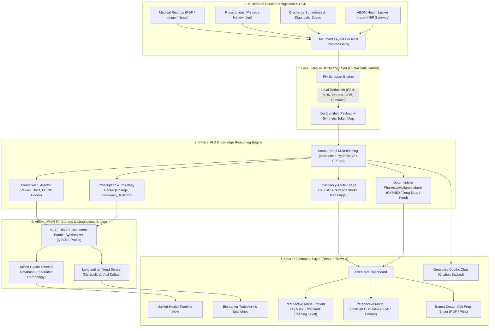
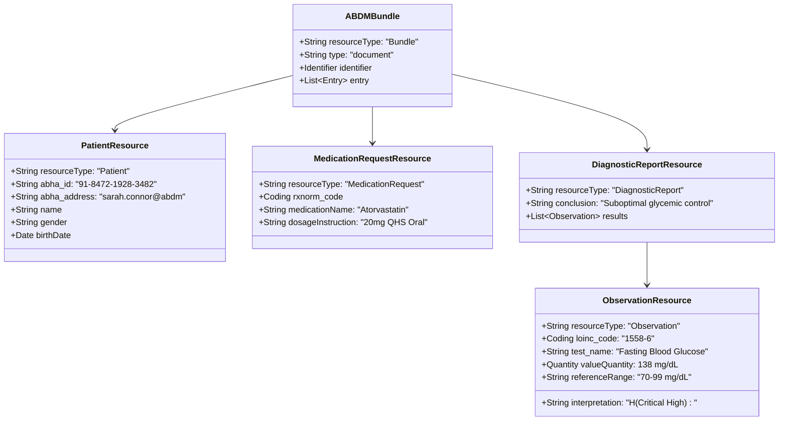

# VitalPulse AI — Architecture & Hackathon Pitch Deck
**Challenge:** AI-Powered Personal Health Copilot (Round 1 Submission)

---

## Part 1: System Architecture Blueprint

### 1. End-to-End Clinical Data Pipeline

---

### 2. ABDM / ABHA Schema & FHIR R4 Alignment

VitalPulse AI is architected natively around the **Ayushman Bharat Digital Mission (ABDM)** standards promulgated by the National Health Authority (NHA) and National Resource Centre for EHR Standards (NRCES):

---

## Part 2: Hackathon Presentation Slides (5-Slide Pitch)

### Slide 1: The Title & Hook
- **Title:** VitalPulse AI — The Intelligent Personal Health Copilot
- **Subtitle:** Transforming Fragmented Medical Records into Actionable, Plain-Language Health Intelligence
- **The Problem:** 
  - Healthcare information is trapped across cryptic lab PDFs, handwritten prescriptions, and scattered discharge notes.
  - Over 80% of patients do not comprehend their medical reports, resulting in medication non-adherence, delayed interventions, and severe medical anxiety.
- **Our Vision:** Empower individuals with an intuitive, HIPAA-sanitized, ABDM-ready copilot that bridges the gap between clinical data and patient comprehension.

---

### Slide 2: Core Innovations & Round 1 Architecture
- **Multimodal Intelligence & OCR:** Seamlessly ingests lab panels, prescriptions, and discharge summaries; extracts biomarkers, LOINC codes, active medications, and diagnoses.
- **Dual-Perspective Synthesis:**
  - *Patient Lay View:* Explains complex metrics (e.g., HbA1c 7.2%, eGFR 88) at a clear 6th-grade reading level.
  - *Clinician CDS View:* Structures findings in clinical SOAP formats for physicians.
- **Zero-Trust PHI Isolation:** Automatic Safe Harbor redaction of 18 identifiers *prior* to any AI inference.
- **Deterministic Pharmacovigilance:** Guards against critical drug-drug and food-drug contraindications (e.g., Grapefruit with Atorvastatin, Lisinopril with potassium).

---

### Slide 3: Bonus Features — ABDM Readiness & Multilingual Access
- **Native ABDM & ABHA Integration:**
  - Linked directly to patient's 14-digit ABHA ID (`91-8472-1928-3482`).
  - Converts unstructured clinical observations into standard **HL7 FHIR R4 Document Bundles** compliant with Indian NRCES specifications.
  - Interoperable across Indian Health Information Providers (AIIMS, Apollo, Dr. Lal PathLabs).
- **True Regional Multilingual Support:**
  - Instant toggle between **English, Hindi (हिन्दी), Telugu (తెలుగు)**, Spanish, French, and German.
  - Culturally contextualized lay-language explanations and physician consultation questions.

---

### Slide 4: Unified Health Timeline & Longitudinal Trajectory
- **Unified Health Profile:** Consolidates episodic records from diverse hospitals into a single, searchable chronological stream (Labs, Prescriptions, Scans, Summaries).
- **Longitudinal Trend Tracking:** Monitors metabolic progression over 6 months with directional delta alerts (e.g., Fasting Glucose rising from 112 -> 124 -> 138 mg/dL).
- **Actionable Physician Prep Sheet:** Generates prioritized consultation questions so patients maximize their 10-minute doctor visits.

---

### Slide 5: Tech Stack Defensibility & Roadmap
- **Tech Stack:**
  - Backend: FastAPI, Pydantic v2, Instructor, HL7 FHIR R4, OpenAI GPT-4o with deterministic clinical fallbacks.
  - Frontend: React 18, Vite, Tailwind CSS v4, Lucide Icons.
- **Clinical Safety Guardrails:** Deterministic red-flag triage detection (acute myocardial infarction & stroke emergency escalations).
- **Round 2 & Production Roadmap:**
  - Direct integration with ABDM M1/M2/M3 Sandbox milestones.
  - Continuous Glucose Monitor (CGM) & Apple HealthKit / Google Health Connect wearable streaming.
  - Edge OCR via WebAssembly for 100% on-device document extraction.

---

## Part 3: Live Demo Script (Step-by-Step for Judges)

1. **Upload & Instant OCR (0:00 - 0:45):**
   - Click the **"Medical Records & OCR"** tab.
   - Click the preset scenario: **"Type 2 Diabetes & Statins"**.
   - Click **"Process Document"**: Point out the live **Safe Harbor PHI Redaction Preview** replacing SSN, DOB, and patient names.
2. **Dual-Perspective View (0:45 - 1:30):**
   - Switch back to the **"Executive Dashboard"**.
   - Show the dynamic biomarker cards: Fasting Glucose (138 mg/dL - High), HbA1c (7.2% - High), eGFR (88 mL/min - Normal).
   - Toggle between **"Patient Lay View"** (simple language) and **"Clinical Reference View"** (SOAP notes).
   - Highlight the **Pharmacovigilance Alert**: *Grapefruit interaction with Atorvastatin*.
3. **ABDM Locker & Unified Timeline (1:30 - 2:15):**
   - Click **"Unified Health Timeline"**: Show records merged across Dr. Lal PathLabs, Apollo Hospitals, and AIIMS.
   - Click **"ABDM Locker & FHIR"** in the top navigation: Show the verified ABHA ID (`91-8472-1928-3482`) and 1-click **HL7 FHIR R4 JSON export**.
4. **Multilingual & Doctor Prep Sheet (2:15 - 3:00):**
   - Change language to **Hindi (हिन्दी)** or **Telugu (తెలుగు)**: Show how summaries, questions, and interface seamlessly translate.
   - Click **"Doctor Prep Sheet"**: Show the printable, exportable consultation summary for the patient's next clinical visit.
